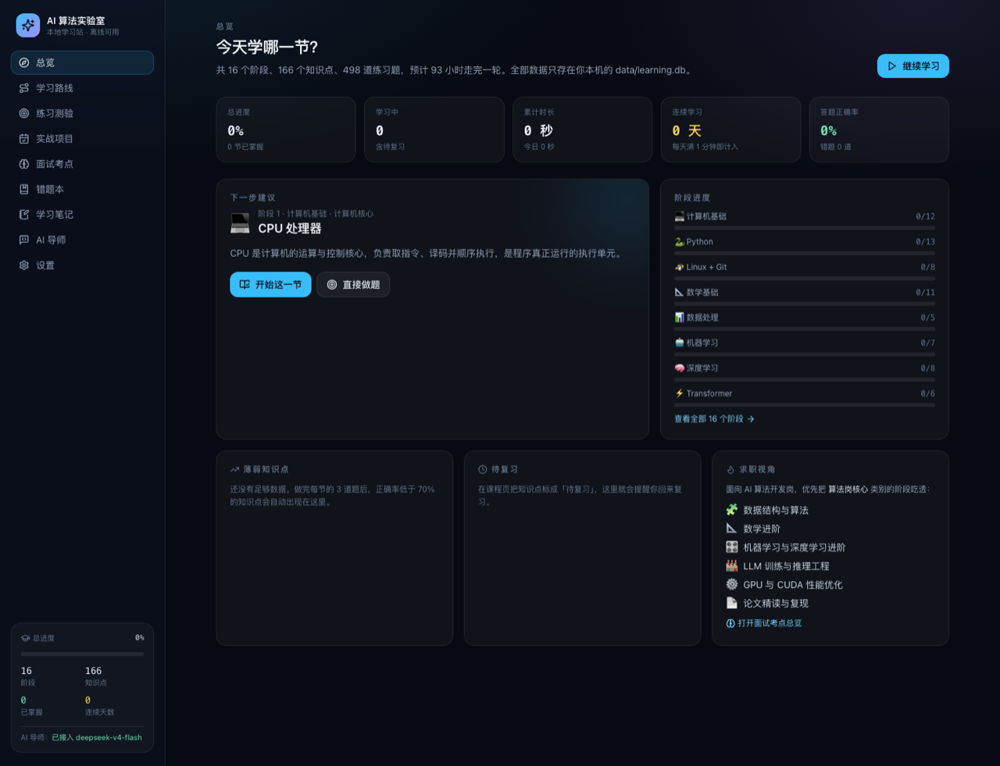
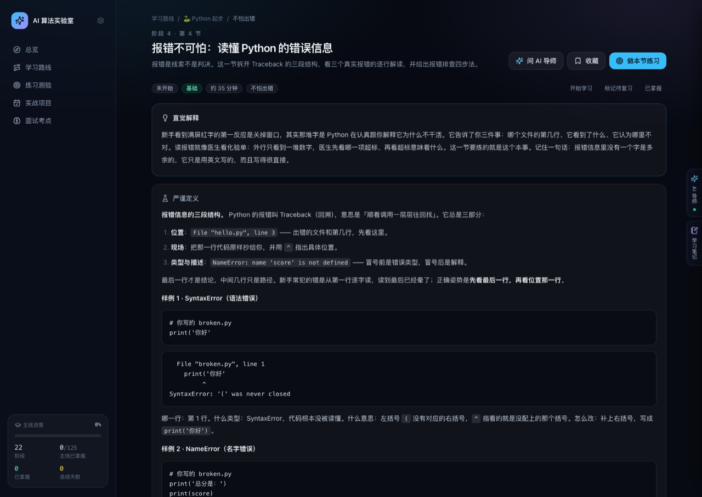
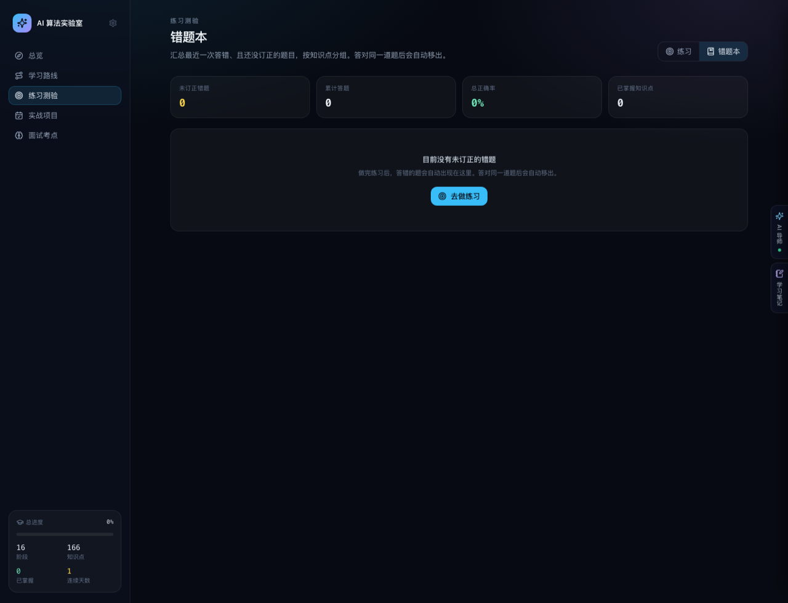
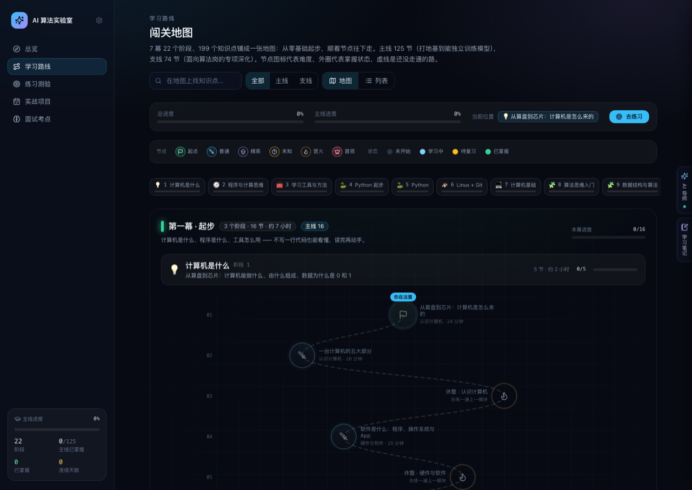
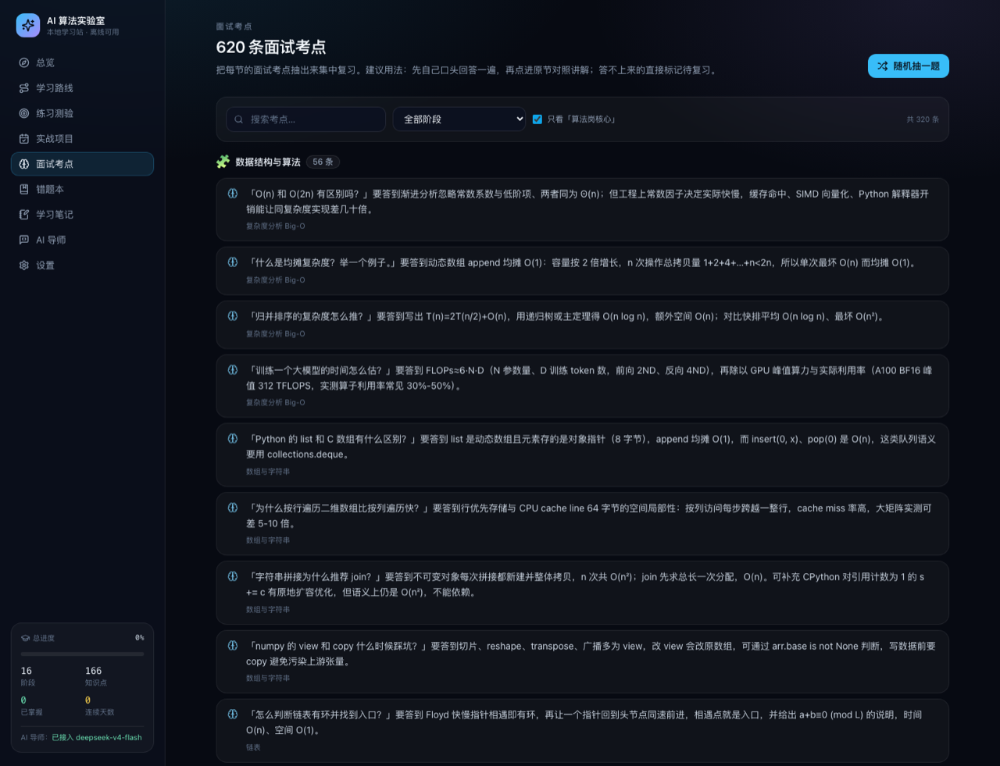

# AI 算法实验室 · 本地学习站

> 一个**完全本地运行**的计算机与 AI 学习网站，读者设定是**从零开始、想走到 AI 算法开发岗的人**。
> 从「计算机是什么」讲起，7 幕 22 个阶段一路铺到「训练自己的大模型」。
> 无需注册登录、无账号系统、无云端依赖，学习数据全部保存在你自己的电脑上。



## 它解决什么问题

网上学 AI 的路径太碎：课程东一节西一节，学完不知道会了什么、缺什么，面试前也没法集中复习。
这个学习站把 **16 个阶段 / 166 个知识点** 串成一条从计算机基础到 LLM 训练推理的完整路线，并且：

- 每节都按「直觉解释 → 严谨定义 → 核心公式 → **与 AI 算法开发的联系** → 示例代码 → 常见错误 → **面试考点** → 延伸资源」组织
- 每节配 3 道题（选择 / 简答 / 编程），答错自动进错题本，正确率低于 70% 的知识点自动进薄弱清单
- 学习路线做成**《杀戮尖塔》风格的闯关地图**：199 个知识点铺成七幕，模块之间是营火休整点，阶段尽头是通关检验，走通的路会亮起来
- **主线 / 支线分层**：主线 125 节先把地基打完（约 55 小时），支线 74 节面向算法岗深化，可以按目标岗位按需补
- **学习计划**：填「每周能投入几小时」，自动算出主线还要多久、每幕预计哪天完成、这周先学哪几节
- 620 条面试考点单独汇总成页，支持**随机抽一题**做模拟面试
- 进度、错题、笔记、学习时长全部写入本地 SQLite，关掉浏览器也在，换机器拷一个文件就走

## 界面

| 课程学习 | 练习测验 |
| --- | --- |
|  |  |

| 学习路线 | 面试考点 |
| --- | --- |
|  |  |

## 课程结构：七幕

| 幕 | 阶段 | 面向零基础的处理 |
| --- | --- | --- |
| **第一幕 · 起步** | 1 计算机是什么 · 2 程序与计算思维 · 3 学习工具与方法 | 从「为什么会有计算机」讲起，**不写一行代码**，先建立概念和工具感 |
| **第二幕 · 编程入门** | 4 Python 起步 · 5 Python · 6 Linux + Git | 从装环境、跑第一行代码、读报错开始，再学语法与工程工具 |
| **第三幕 · 计算机科学基础** | 7 计算机基础 · 8 算法思维入门 · 9 数据结构与算法 | 先建立算法直觉，再上数据结构与算法；组成原理排在编程之后 |
| **第四幕 · 数学** | 10 数学衔接 · 11 数学基础 · 12 数学进阶 | 显式接上高中数学（函数、Σ、极限、集合），再进入线代、微积分、概率与优化 |
| **第五幕 · 数据与经典机器学习** | 13 数据处理 · 14 机器学习 | 把脏数据变成可训练数据集，跑通第一批模型 |
| **第六幕 · 深度学习与大模型** | 15 深度学习 · 16 ML/DL 进阶 · 17 Transformer · 18 LLM Engineering · 19 AI Agent | 现代 AI 的主干 |
| **第七幕 · 算法岗进阶** | 20 LLM 训练与推理工程 · 21 GPU 与 CUDA · 22 论文精读与复现 | 面试与工作的正面战场 |

内容规模：

| 指标 | 数量 |
| --- | --- |
| 幕 / 阶段 | 7 幕 / 22 个阶段 |
| 知识点 | 199 节（**主线 125** / 支线 74） |
| 练习题 | 597 道 |
| 面试考点 | 719 条 |
| 代码示例 | 199 段（Python / CUDA / bash，均为可直接运行的完整代码） |
| 外部资源 | 291 条（论文 arXiv 链接、官方文档） |
| 预计学时 | 约 109 小时（主线约 55 小时） |

**零基础怎么用**：打开「总览」→ 在学习计划里填每周能投入几小时 → 按「这周先学这几节」的顺序走。
先把主线走完（能独立训练并部署一个小模型），再按目标岗位补支线。

几个例子，说明内容深度：

- **11 数据结构与算法**：附 78 题 LeetCode 高频题单（题号经官方 API 核对），覆盖复杂度推导、Top-K、编辑距离、Viterbi、滑窗注意力等真实场景
- **12 数学进阶**：SVD 与 Eckart–Young、KL 散度与 RLHF 约束、凸优化与 SVM 对偶、条件数与 fp16 loss scaling，公式全部 KaTeX 渲染
- **14 LLM 训练与推理工程**：显存账本（7B = 14GB bf16 权重 + 56GB Adam 状态 + …）、ZeRO 三阶段通信量、LoRA / QLoRA / DPO / PagedAttention 的真实代码
- **15 GPU 与 CUDA**：A100/H100 带宽与算力、Roofline、内存合并访问、从朴素到寄存器分块的 GEMM、FlashAttention 在线 softmax

## 快速开始

环境要求：**Node.js ≥ 22.18**（使用内置 `node:sqlite`，测试直接运行 TypeScript，无任何原生编译依赖）。

```bash
git clone https://github.com/kiphy-axp/AI-Learning.git
cd AI-Learning

./start.sh          # 一键：装依赖 → 构建 → 启动 → 开浏览器（默认 http://127.0.0.1:4173）
./start.sh 5000     # 指定端口，端口被占用会自动 +1
```

macOS 用户也可以直接**双击 `启动学习站.command`**。

开发模式：

```bash
npm install
npm run dev         # Vite 开发服务器（前端热更新）
npm run api         # 另一个终端启动本地 API
```

## 技术栈

- **前端**：React 19 + TypeScript + Tailwind CSS 3，Vite 8 构建，HashRouter 单页应用
- **后端**：Node 内置 `node:http` + `node:sqlite`，**零运行时依赖**（不用 Express、不用 Prisma、不用 Docker）
- **渲染**：自研轻量 Markdown 渲染器 + KaTeX 公式 + 代码块一键复制
- **AI 导师**：任意 OpenAI 兼容接口（OpenAI / DeepSeek / OpenRouter / 本地 Ollama / OpenCode），未配置时自动降级为基于课程内容的离线讲解

## 在网页里直接跑代码

讲义里的 Python / Bash 代码块、练习里的编程题、右侧面板的**代码试验场**，都有一个「运行代码」按钮：代码会落到临时目录里**在你本机执行**，输出、报错、退出码、耗时直接显示在页面上，不用切到终端。

- **讲义代码块**：点一下就能验证正文结论（例：二分查找那节的例子实跑输出「逐个查找 1000000 次 25.9ms vs 二分 20 次 0.010ms，相差 50000 倍」）
- **练习编程题**：编辑器下面直接跑，程序要输入时点「程序输入」；判分纳入运行结果，**跑过就必须跑通**
- **代码试验场**：不绑题目，随便写；`⌘/Ctrl + Enter` 运行，代码按语言存在浏览器本地，可展开到整页

- 支持 Python 3 与 Bash（启动时自动探测；CUDA 需要 NVIDIA 显卡 + nvcc，通常没有，所以 GPU 阶段的代码只能阅读）
- 程序需要 `input()` 时，点「程序输入」把内容填进去
- 安全边界：每次运行一个独立临时目录（同时作为工作目录与 `HOME`）、8 秒墙钟超时 + CPU 时间上限、stdout/stderr 各截断 64KB、不继承你的环境变量
- 这是给本机个人使用的功能：服务只监听 `127.0.0.1`，代码和你在终端里敲 `python3 xxx.py` 等价，请不要运行来源不明的代码

## AI 导师配置（可选）

不配也能用：导师会基于当前小节的内容、公式、示例代码和你的薄弱知识点做**离线讲解**。

想接真实模型，复制模板填上 Key 即可：

```bash
cp .env.example .env
```

```dotenv
TUTOR_PROVIDER=deepseek
TUTOR_BASE_URL=https://api.deepseek.com/v1
TUTOR_MODEL=deepseek-chat
TUTOR_API_KEY=sk-xxxxxxxx
```

重启服务生效。也可以直接在学习站「设置」页填写，Key 会用 AES-256-GCM 加密后存入本地数据库（优先级高于 `.env`）。

> `.env` 与 `data/` 均已被 `.gitignore` 忽略，Key 不会进入 Git 历史。

支持 6 种提问模式：简单解释 / 深入解释 / 举例说明 / 练习模式 / 苏格拉底式引导 / 自由提问。

## 功能一览

| 页面 | 作用 |
| --- | --- |
| 总览 | 学习计划（每周投入 → 剩余时间 → 每幕完成日期 → 这周该学哪几节）、主线/总进度、累计时长、连续天数、薄弱知识点 |
| **学习路线（闯关地图）** | 七幕 × 22 阶段的节点地图：节点=知识点（起点 / 普通 / 精英 / 未知 / 营火 / 首领），虚线=未走通的路，实线=已掌握；支持「主线 / 支线」筛选、吸顶阶段跳转栏、搜索高亮、当前位置标记；可切「列表」视图批量改状态与筛选 |
| 知识点讲义 | 从地图节点进入：结构化讲义 + KaTeX 公式 + 代码复制 + 收藏 + 随手记笔记 |
| 练习测验（含错题本） | **编程题可以在网页里直接运行**（本机执行，见下）；选择题自动判分；**简答题按「意思到了」判**——同义写法、换词表述、举例子都算命中，命中任一要点即通过，判错可自己改判或让 AI 批改；编程题按关键片段校验并给参考答案。切到「错题本」视图看最近答错且未订正的题目，按知识点分组、一键重做 |
| 实战项目 | 六级项目路线（数据分析 → 经典 ML → CNN → 从零实现 Transformer → LoRA 微调 → 论文复现），任务可勾选 |
| 面试考点 | 汇总 719 条考点，支持搜索与「随机抽一题」模拟面试 |
| 右侧面板 · AI 导师 | 默认收起为右缘贴边标签，点一下或讲义页的「问 AI 导师」展开；自动带上当前知识点的定义 / 公式 / 代码与你的薄弱项；6 种提问模式 |
| 右侧面板 · 学习笔记 | 与导师共用同一个抽屉，随时打开边看边记；Markdown + LaTeX，可关联到具体知识点 |
| 右侧面板 · 代码试验场 | 不绑题目的自由编辑器，随手写随手跑（⌘/Ctrl + Enter）；代码按语言存在浏览器本地，也可展开到整页 `#/playground` |
| 设置 | 点左上角「AI 算法实验室」图标进入：模型接口配置、数据导出 / 导入 |

> 右侧面板支持深链接：`?dock=tutor` 展开导师、`?dock=notes` 展开笔记、`?dock=playground` 展开试验场，`?dock=0` 收起。

## 数据与隐私

- 数据库：`data/learning.db`（SQLite），保存进度、错题、笔记、学习时长、设置
- 加密密钥：`data/.secret`（权限 0600），用于加密本地保存的 API Key
- **本站不采集任何数据、不发起任何外部请求**，唯一的外部请求是你主动配置的模型接口
- 备份：直接复制 `data/learning.db`，或在「设置」页导出 JSON
- 恢复出厂：删除 `data/` 目录

## 目录结构

```text
content/
  SCHEMA.md             课程内容 schema 说明
  stages/*.json         16 个阶段的课程内容
server/
  index.mjs             HTTP 服务：静态站点 + 本地 API
  db.mjs                SQLite 数据层（进度 / 错题 / 笔记 / 设置）
  tutor.mjs             AI 导师：OpenAI 兼容接口 + 离线回退
  env.mjs               零依赖 .env 加载器
web/
  src/pages/            11 个页面（含代码试验场）
  src/components/       闯关地图、右侧面板（导师 / 笔记）、Markdown + KaTeX 渲染、UI 组件
  src/lib/              内容索引、API 客户端、全局状态、面板状态
scripts/
  validate-content.mjs  课程内容校验
  restructure.mjs       七幕结构重排（一次性）
  migrate-legacy-content.mjs  从旧版内容源迁移（一次性）
  screenshot.mjs        走 CDP 按真实时间截图（开发用）
tests/                  内容规模与结构测试
data/                   本地数据库（Git 忽略）
dist/                   构建产物（Git 忽略）
```

## 常用命令

```bash
npm run validate    # 校验全部课程内容是否符合 schema（结构、字段、题型）
npm test            # 内容规模与结构测试
npm run typecheck   # TypeScript 类型检查
npm run build       # 构建前端到 dist/
npm start           # 启动本地服务（需先 build）
```

## 贡献内容

课程内容都是纯 JSON，按 [`content/SCHEMA.md`](content/SCHEMA.md) 编写，放在 `content/stages/stage-<N>.json`。
加完跑 `npm run validate` 确认通过即可。

## License

个人学习与教学用途。
